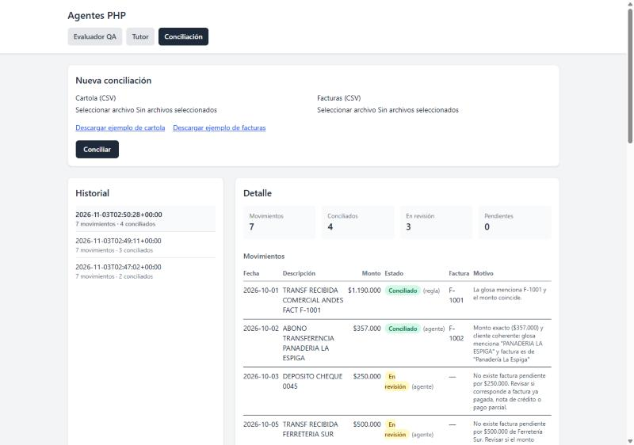
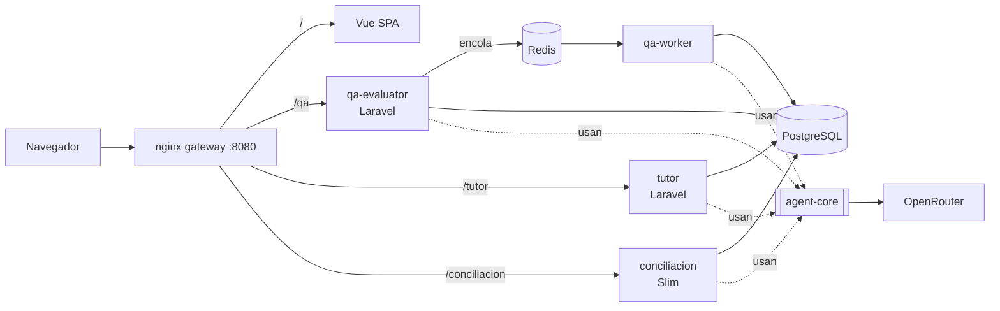
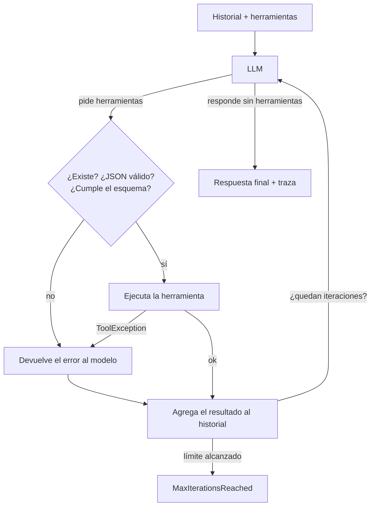

# agentes-php

> Tres aplicaciones con agentes de IA (*tool calling* real) que comparten un mismo núcleo en PHP: un evaluador de respuestas, un tutor adaptativo y un asistente de conciliación bancaria.

[](https://github.com/DHat3r/agentes-php/actions/workflows/ci.yml)



## Qué hay aquí

| App | Framework | Qué hace el agente |
|-----|-----------|--------------------|
| **Evaluador QA** (`apps/qa-evaluator`) | Laravel 13 + cola Redis | Responde preguntas de un foro, pide a un LLM juez que compare su respuesta con la humana y la mejora hasta aprobar. |
| **Tutor** (`apps/tutor`) | Laravel 13 | Genera ejercicios de matemáticas del nivel del estudiante, los corrige y ajusta su nivel. |
| **Conciliación** (`apps/conciliacion`) | Slim 4 + PHP-DI | Cruza los abonos de una cartola con facturas y deja los casos dudosos para revisión humana. |

Las tres usan `packages/agent-core`, un paquete en **PHP puro, sin framework**, con el ciclo del agente. Que lo usen tanto Laravel como Slim es la prueba de que el núcleo no depende del framework.

Si quieres entender el ciclo por dentro, sigue la [guía para reescribirlo](docs/GUIA_CICLO_DEL_AGENTE.md) usando sus tests.

El evaluador QA es una nueva versión de [Sistemas2](https://github.com/DHat3r/Sistemas2), un proyecto universitario hecho con Gonzalo Gaete en Python, Kafka y Flink.

## Stack

| Capa | Tecnología |
|------|------------|
| Núcleo del agente | PHP 8.5, Guzzle, PHPUnit |
| Backend | Laravel 13 (2 apps), Slim 4 + PHP-DI (1 app) |
| LLM | OpenRouter con modelos gratuitos y fallback automático |
| Frontend | Vue 3, Vite, Tailwind CSS 4 |
| Datos | PostgreSQL 17 (una base por app), Redis 7 (cola y caché) |
| Infraestructura | Docker Compose, nginx como gateway, GitHub Actions |

## Cómo ejecutarlo

```bash
git clone https://github.com/DHat3r/agentes-php.git
cd agentes-php
cp .env.example .env        # pega tu OPENROUTER_API_KEY (gratis en openrouter.ai/keys)
docker compose up --build
```

Abre `http://localhost:8080`. Las bases se migran y se cargan con datos de ejemplo al arrancar.

Sin key la app también arranca: las respuestas del agente fallan con un mensaje claro ("Falta OPENROUTER_API_KEY").

| Ruta | Servicio |
|------|----------|
| `/` | Frontend Vue |
| `/qa/api/...` | Evaluador QA (`stats`, `questions`, `evaluations`, `traffic`) |
| `/tutor/api/...` | Tutor (`students`, `topics`, `exercises`) |
| `/conciliacion/api/...` | Conciliación (`conciliaciones`, `ejemplos/{cartola\|facturas}`) |

## Tests

```bash
cd packages/agent-core && composer install && vendor/bin/phpunit
cd apps/qa-evaluator   && composer install && cp .env.example .env && php artisan key:generate && vendor/bin/phpunit
```

Son **158 tests** (núcleo 36, QA 51, tutor 32, conciliación 39) y **ninguno llama a la API real**: usan `FakeLlmClient`, un modelo simulado que sigue un guion de respuestas. Por eso CI no necesita la key y los tests son deterministas.

## Arquitectura



### El ciclo del agente (`packages/agent-core/src/Agent.php`)



Hay dos tipos de error y cada uno se maneja distinto:
- **Errores del modelo** (herramienta inexistente, argumentos inválidos, reglas de negocio): se le devuelven como resultado, para que se corrija solo.
- **Errores de red** (`LlmException`: timeout, 429, 5xx): salen del ciclo, porque reintentar es decisión de quien llama. En QA reintenta la cola; en el tutor se responde 503.

## Decisiones técnicas

- **Núcleo en PHP puro con puertos y adaptadores.** El agente conoce las interfaces `LlmClient` y `Tool`, nunca a Laravel ni a OpenRouter. Producción inyecta `OpenRouterClient` y los tests inyectan `FakeLlmClient`.
- **Las reglas de negocio viven en las herramientas, no en el prompt.** `conciliar_movimiento` rechaza montos distintos, `guardar_resultado` solo acepta respuestas que el juez ya calificó y `registrar_ejercicio` exige el nivel real del estudiante. El modelo puede equivocarse, pero no puede romper los datos.
- **Primero lo determinista, el LLM solo para lo ambiguo.** En la conciliación, un pago que trae el número de factura se concilia con una regla, sin llamar al modelo. En el tutor, subir o bajar de nivel es una regla fija (3 correctas suben, 2 incorrectas bajan). Así es más barato, más rápido y testeable.
- **Cola con reintentos en vez de Kafka + Flink.** En el original, Flink reenviaba las preguntas fallidas a Kafka. Aquí un job de Laravel con `tries = 3` y `backoff = [10, 30, 60]` hace lo mismo en pocas líneas. El job es idempotente: no repite una evaluación ya completada.
- **Redis aplica la política LRU.** El proyecto original implementaba la expulsión de la caché a mano; aquí basta `maxmemory-policy allkeys-lru`.
- **Laravel y Slim a propósito.** Laravel resuelve mucho por convención (colas, migraciones, validación). En Slim, el contenedor, el SQL y las migraciones están escritos a mano. Tener ambos muestra que el núcleo es portable.
- **Modelos gratuitos con fallback.** `OPENROUTER_MODEL` acepta hasta 3 modelos separados por coma; si uno responde 429, OpenRouter prueba el siguiente. El límite de 3 no aparece en la documentación: lo descubrimos probando contra la API real.
- **Monorepo con *path repository* de Composer.** Cada app instala `agent-core` desde `../../packages/agent-core`, así un cambio en el núcleo se prueba contra las tres apps en el mismo commit.

## Resultados

Probado con modelos gratuitos reales (nemotron) usando los datos de ejemplo:

| Caso | Resultado |
|------|-----------|
| Conciliación de la cartola de ejemplo (7 abonos) | 4 conciliados (2 por regla, 2 por el agente) y 3 a revisión con su motivo, en unos 27 s |
| Evaluación QA de "¿Qué es una API?" | Puntaje general 0.9 |
| Tutor | Genera un ejercicio en ~11 s y lo corrige en ~5 s, aceptando formatos equivalentes ("$250 pesos" = 250) |

La prueba real encontró un bug que los tests simulados no podían ver: el banco escribe "PANADERIA" sin tilde y la búsqueda por cliente no encontraba "Panadería". Se arregló normalizando acentos y quedó cubierto por un test.

## Qué mejoraría con más tiempo

- Autenticación (Laravel Sanctum) para que cada estudiante vea solo su progreso.
- Correr el agente de la conciliación en una cola, como en QA, para no mantener la petición HTTP abierta ~30 s.
- Búsqueda semántica con embeddings (pgvector) en `buscar_respuestas_previas`, en vez de palabras clave.
- Métricas de uso por modelo (tokens, latencia, tasa de fallback) a partir de la traza.
- Una suite de evaluación ("evals") que corra los mismos casos contra varios modelos y compare resultados.

## Autor

Leandro Norambuena · [GitHub](https://github.com/DHat3r)
